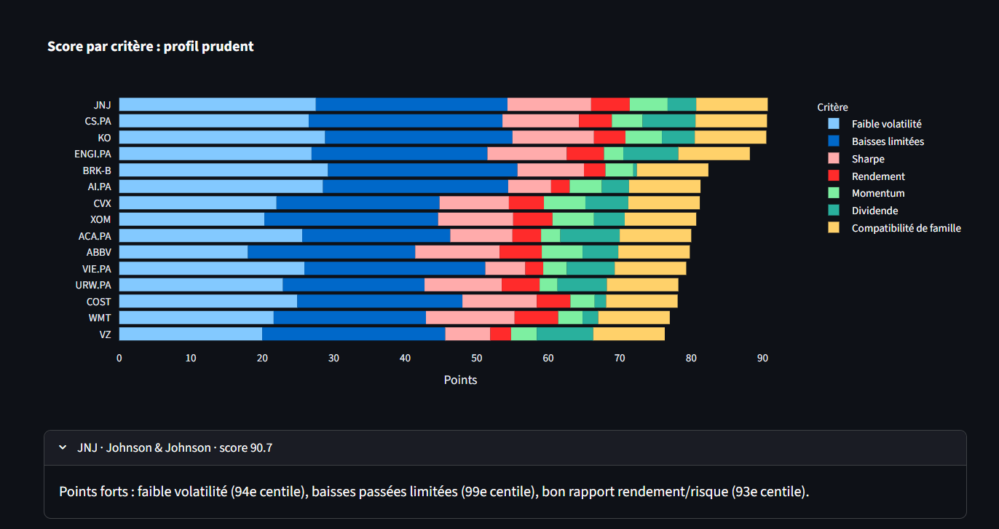

# Stock Screener

A personalised stock recommendation system: given an investor's profile (risk appetite, horizon, sectors, price range), it ranks stocks, explains each choice, builds a portfolio and **backtests the method without look-ahead bias**.

> ⚠️ **Educational project. This is not investment advice.** Rankings describe past behaviour of a small set of stocks; they do not predict the future and can lose money.

**[Live demo](https://stock-screener-gxdqcb3zs8omhuhqsmjz5c.streamlit.app/)** · Python · pandas · scikit-learn · SQLite · Streamlit

-->




## Contents

1. [What it does](#what-it-does)
2. [Main findings](#main-findings)
3. [How it works](#how-it-works)
4. [Backtest methodology and results](#backtest-methodology-and-results)
5. [Data quality](#data-quality)
6. [Limitations](#limitations)
7. [Project structure](#project-structure)
8. [Getting started](#getting-started)
9. [Possible next steps](#possible-next-steps)
10. [Data and licence](#data-and-licence)

## What it does

- Collects 10 years of daily prices (adjusted for splits and dividends) and fundamentals for **89 stocks** (39 CAC 40 constituents and 50 large S&P 500 stocks) plus two benchmark indices, and stores them in SQLite.
- Computes risk and performance indicators for each stock.
- Scores stocks for three investor profiles (**prudent, balanced, dynamic**), adjusted for the investment horizon and a preference for dividends.
- Groups stocks into four behavioural families with K-means clustering.
- Builds a portfolio with long-only, capped weights (Markowitz optimisation).
- Backtests the whole process quarter by quarter, using only the data that was available at each date, and compares it with simple benchmarks.
- Serves everything in a Streamlit app with a plain-language explanation for each recommended stock.

## Main findings

Backtest from 31 Dec 2018 to 30 Oct 2026: 10 stocks, quarterly rebalancing, 0.1 % transaction costs, maximum 20 % per stock.

| | Annualised return | Volatility | Sharpe | Max drawdown | Turnover per rebalance |
|---|---|---|---|---|---|
| **Prudent** | +10.0 % | 13.7 % | 0.73 | −32.4 % | 55 % |
| **Balanced** | +13.5 % | 16.7 % | 0.81 | −36.0 % | 75 % |
| **Dynamic** | +15.9 % | 20.2 % | 0.79 | −32.9 % | 98 % |
| Equal-weight, whole universe (89 stocks) | +16.8 % | 16.4 % | 1.02 | −33.8 % | |
| S&P 500 | +14.8 % | 19.0 % | 0.78 | −33.9 % | |
| CAC 40 | +6.7 % | 18.4 % | 0.36 | −38.6 % | |

What the results do and do not show:

- **The profiles differ as intended on risk and return**: volatility rises from 13.7 % to 20.2 % and return from 10.0 % to 15.9 % as the profile gets bolder.
- **No profile beats the equal-weight portfolio of the whole universe**, either on return or on Sharpe ratio. In this test, the scoring does not add value over simple diversification.
- **The prudent profile reduces volatility but not the worst drawdown** (−32.4 % vs −33.8 %): the March 2020 crash hit almost every stock at once.
- These results cover **one 8-year period** and an **universe affected by survivorship bias**. Differences of a few points in Sharpe ratio or return are within the range of chance, so no conclusion about the scoring's effectiveness should be drawn.
- The four metrics at the top of the app are measured on the same 3-year window used to pick the stocks, so they are **in-sample and optimistic** (Sharpe ratios of about 2 to 3). The **Backtest** tab is the honest evaluation.

## How it works

```
Yahoo Finance → SQLite → indicators → scoring + clustering → portfolio → backtest
                                                   ↓
                                              Streamlit app
```

### 1. Indicators (`src/indicateurs.py`)

Computed on the last 3 years (756 trading days) from adjusted closing prices; stocks with less than one year of history are excluded.

| Indicator | Definition |
|---|---|
| Annualised return | Compound growth rate, 252 trading days per year |
| Annualised volatility | Standard deviation of daily returns × √252 |
| Sharpe ratio | Annualised return ÷ annualised volatility (risk-free rate assumed 0 %) |
| Beta | Covariance with the local index ÷ variance of the index (CAC 40 for Paris and Amsterdam tickers, S&P 500 otherwise) |
| Max drawdown | Worst fall from a previous peak |
| Momentum | Performance over 6 and 12 months |

Every function takes prices only and can be cut at any date, which is what guarantees the backtest uses no future information.

### 2. Scoring (`src/scoring.py`)

1. Each indicator becomes a score between 0 and 1: the stock's **percentile rank across the whole universe**, computed *before* filtering so that a stock keeps the same score whatever filters are chosen.
2. Scores are combined with profile weights (starting hypotheses, not validated truths):

| Criterion | Prudent | Balanced | Dynamic |
|---|---|---|---|
| Low volatility | 35 % | 20 % | 5 % |
| Limited drawdown | 25 % | 15 % | 5 % |
| Sharpe ratio | 15 % | 25 % | 20 % |
| Annualised return | 10 % | 20 % | 30 % |
| Momentum (6 and 12 months) | 5 % | 20 % | 40 % |
| Dividend yield | 10 % | 0 % | 0 % |

3. **Horizon adjustment** (an unvalidated modelling assumption): short horizon × 1.5 on momentum, × 1.3 on drawdown, × 0.8 on return; long horizon × 1.2 on Sharpe, × 0.6 on momentum, × 0.8 on volatility. Weights are then renormalised. Asking for dividends adds 15 points of weight to the dividend criterion.
4. **Clustering**: K-means (k = 4) on volatility, drawdown, beta, return and 12-month momentum gives four families named by increasing mean volatility (*Defensive, Moderate, Dynamic, Speculative*). The family's compatibility with the profile contributes 10 % of the score.
5. **Filters**: sectors, price range (in each stock's own currency), minimum liquidity, optional cap on the number of stocks per sector.
6. **Explanation**: each recommendation lists the criteria where the stock ranks high for that profile, and those to watch.

### 3. Portfolio (`src/portefeuille.py`)

Three weighting methods: equal weight, **minimum variance** (default for the prudent profile) and **maximum Sharpe** (default for the balanced and dynamic profiles). Constraints: no short selling, weights sum to 100 %, maximum 20 % per stock by default.

Because Markowitz optimisation is fragile, two safeguards are used: the covariance matrix is estimated with **Ledoit-Wolf shrinkage**, and expected returns are shrunk 50 % towards their average so that one lucky past performance cannot dominate the portfolio.

### 4. App (`app.py`)

Five tabs: **Portfolio** (weights, scores, sector split), **Why these stocks?** (contribution of each criterion), **Risk / return map**, **Backtest** and **Method and limitations**.

## Backtest methodology and results

At each quarter-end `t`:

1. indicators are computed using **only prices up to `t`**;
2. stocks are scored, the top 10 are selected and their weights optimised using the 3 years before `t`;
3. the portfolio is rebalanced, paying 0.1 % of the amount traded;
4. it then drifts with market prices until the next rebalance.

Benchmarks use the same rules and costs: an equal-weight portfolio of the whole universe, the S&P 500 and the CAC 40.

- **No look-ahead**: an automated test multiplies the prices of several stocks by 5 *after* a given date and checks that the backtest curve up to that date is unchanged.
- **Fundamentals (P/E, dividend) are excluded from the backtest**, since the data source only provides today's values; using them would leak future information.
- Costs paid by the strategies are 0.2 % to 0.4 % of capital per year, depending on turnover.

## Data quality

Backtests are only as good as their data, and this project found a real error:

- A diagnostic tool (`python -m src.diagnostic`) lists the days when the strategy moved most and which holdings caused it, and flags every daily price move above a threshold, together with the following day's move.
- It revealed that **Stellantis (`STLAP.PA`) showed a +95 % one-day jump in January 2021**. The company was created on 16 January 2021 by the merger of PSA and FCA and started trading on 18 January, so the price history stored under this ticker before that date is not comparable. This artefact added about **5 points of annualised return** to the prudent profile's backtest (15.1 % before the fix against 10.0 % after).
- The fix is an explicit `DEBUT_VALIDE` setting in `src/univers.py` that keeps Stellantis only from 18 January 2021, covered by automated tests.
- The collection script now ignores the current trading day, because its last price may be an intraday quote rather than a close.
- After the fix, the daily moves above 20 % that were checked match public events (for example Teleperformance in November 2022, Alstom in April 2026 and Intel in October 2026).

## Limitations

- **Survivorship bias**: the universe is today's constituents. Companies that disappeared or left the indices are missing, which flatters all results, including the benchmarks.
- **One period, one universe**: 8 years and 89 large stocks. Conclusions cannot be generalised.
- **Strategy vs benchmark is not a like-for-like comparison**: the strategies hold 10 stocks, the equal-weight benchmark holds 89, so scoring and diversification effects are mixed.
- **Modelling assumptions are not validated**: profile weights, horizon multipliers and the 10 % cluster bonus are hypotheses. The horizon in particular only changes the criteria weights, while indicators are always measured over 3 years.
- **No currency conversion**: euro and dollar stocks are mixed, and each stock is followed in its own currency.
- **Simplified trading**: execution at the closing price of the signal day, proportional costs, no bid-ask spread and no taxes.
- **Free data**: Yahoo Finance data can contain errors or gaps. A single source is used.
- **Fundamentals are not point-in-time**, so they are not used in the backtest.

## Project structure

```
stock-screener/
├── app.py                  Streamlit application
├── src/
│   ├── univers.py          Tickers and truncated histories (DEBUT_VALIDE)
│   ├── collecte.py         Data collection (yfinance → SQLite)
│   ├── indicateurs.py      Financial indicators
│   ├── scoring.py          Scoring, clustering, filtering, recommendations
│   ├── portefeuille.py     Portfolio optimisation
│   ├── backtest.py         Backtest engine and metrics
│   ├── diagnostic.py       Detection of abnormal moves
│   └── snapshot.py         Lightweight copy of the database for deployment
├── tests/                  Automated tests (pytest)
├── notebooks/              Exploratory analysis
├── data/                   snapshot.db and backtest results (the full database is git-ignored)
└── requirements.txt
```

Module names are in French; the code comments and docstrings are in French as well.

## Getting started

Requires Python 3.11 or later.

```bash
git clone https://github.com/cd-0707/stock-screener.git
cd stock-screener
python -m venv .venv
source .venv/bin/activate        # Windows: .venv\Scripts\activate
pip install -r requirements.txt
pip install pytest jupyter       # only needed for tests and notebooks
```

Run the whole pipeline (from the project root):

```bash
python -m src.collecte                       # download 10 years of data (a few minutes)
python -m src.indicateurs                    # compute and store indicators
python -m src.scoring --profil prudent       # ranked, explained recommendations
python -m src.portefeuille --profil prudent  # portfolio weights
python -m src.backtest --profil prudent      # backtest (saves CSV and HTML chart in data/)
python -m src.diagnostic --profil prudent --seuil 0.2   # data-quality check
pytest -v                                    # run the tests
streamlit run app.py                         # launch the app
```

Profiles are `prudent`, `equilibre` and `dynamique`. Useful options include `--horizon court|moyen|long`, `--secteurs`, `--prix-max`, `--dividendes`, `--nb` and `--max-par-secteur`.

If `data/stock_screener.db` does not exist, the app falls back to the lightweight `data/snapshot.db` included in the repository, which is how the online demo runs. Refresh it with `python -m src.snapshot` after collecting new data.

## Possible next steps

- Forecast **volatility** (the most predictable quantity) with walk-forward validation against a naive "same as last month" baseline.
- Compare each strategy with thousands of **random 10-stock portfolios**, to separate the effect of the scoring from that of diversification.
- Sensitivity analysis on the observation window, rebalancing frequency and costs, published in full.
- Currency conversion, point-in-time fundamentals and a more realistic cost model.
- Continuous integration (tests on every push).

## Data and licence

Price and fundamental data come from Yahoo Finance via the [`yfinance`](https://github.com/ranaroussi/yfinance) library and are used here for educational purposes only. Check Yahoo's terms before reusing them.

Released under the MIT licence.

## Author

**Bénédicte Carminot**: [LinkedIn](https://www.linkedin.com/in/YOUR-PROFILE) · [GitHub](https://github.com/cd-0707)