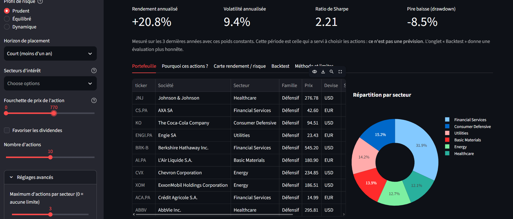
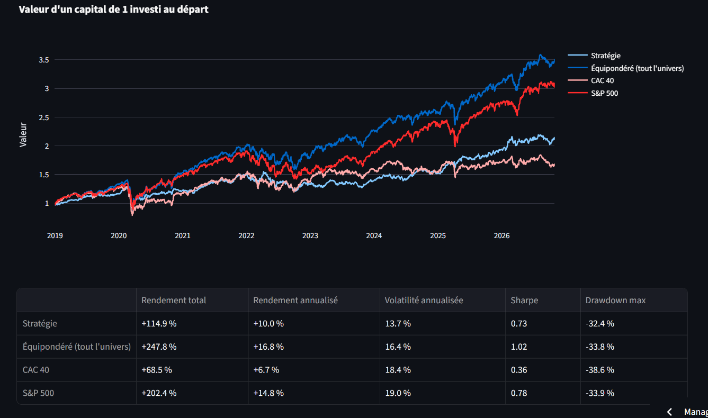

# Stock Screener

A personalised stock recommendation system: given an investor's profile (risk appetite, horizon, sectors, price range), it ranks stocks, explains each choice, builds a portfolio and **backtests the method without look-ahead bias**. An extension forecasts stock volatility, following the research literature, and tests whether it helps.

> ⚠️ **Educational project. This is not investment advice.** Rankings describe past behaviour of a small set of stocks; they do not predict the future and can lose money.

**[Live demo](https://YOUR-APP-NAME.streamlit.app)** · Python · pandas · scikit-learn · SQLite · Streamlit

<!-- Add 2-3 screenshots to docs/img/ and uncomment:


-->

## Contents

1. [What it does](#what-it-does)
2. [Main findings](#main-findings)
3. [How it works](#how-it-works)
4. [Backtest methodology and results](#backtest-methodology-and-results)
5. [Volatility forecasting](#volatility-forecasting)
6. [Data quality](#data-quality)
7. [Limitations](#limitations)
8. [Project structure](#project-structure)
9. [Getting started](#getting-started)
10. [Possible next steps](#possible-next-steps)
11. [References](#references)
12. [Data and licence](#data-and-licence)

## What it does

- Collects 10 years of daily prices (adjusted for splits and dividends) and fundamentals for **89 stocks** (39 CAC 40 constituents and 50 large S&P 500 stocks) plus two benchmark indices, and stores them in SQLite.
- Computes risk and performance indicators for each stock.
- Scores stocks for three investor profiles (**prudent, balanced, dynamic**), adjusted for the investment horizon and a preference for dividends.
- Groups stocks into four behavioural families with K-means clustering.
- Builds a portfolio with long-only, capped weights (Markowitz optimisation).
- Backtests the whole process quarter by quarter, using only the data that was available at each date, and compares it with simple benchmarks.
- Forecasts one-month-ahead volatility with a HAR model and machine-learning extensions, with a strictly chronological out-of-sample evaluation.
- Serves the recommendations in a Streamlit app with a plain-language explanation for each stock.

## Main findings

**Recommendation and backtest.** Backtest from 31 Dec 2018 to 30 Oct 2026: 10 stocks, quarterly rebalancing, 0.1 % transaction costs, maximum 20 % per stock.

| | Annualised return | Volatility | Sharpe | Max drawdown | Turnover per rebalance |
|---|---|---|---|---|---|
| **Prudent** | +10.0 % | 13.7 % | 0.73 | −32.4 % | 55 % |
| **Balanced** | +13.5 % | 16.7 % | 0.81 | −36.0 % | 75 % |
| **Dynamic** | +15.9 % | 20.2 % | 0.79 | −32.9 % | 98 % |
| Equal-weight, whole universe (89 stocks) | +16.8 % | 16.4 % | 1.02 | −33.8 % | |
| S&P 500 | +14.8 % | 19.0 % | 0.78 | −33.9 % | |
| CAC 40 | +6.7 % | 18.4 % | 0.36 | −38.6 % | |

- **The profiles differ as intended on risk and return**: volatility rises from 13.7 % to 20.2 % and return from 10.0 % to 15.9 % as the profile gets bolder.
- **No profile beats the equal-weight portfolio of the whole universe**, either on return or on Sharpe ratio. In this test, the scoring does not add value over simple diversification.
- **The prudent profile reduces volatility but not the worst drawdown** (−32.4 % vs −33.8 %): the March 2020 crash hit almost every stock at once.
- These results cover **one 8-year period** and a **universe affected by survivorship bias**. Differences of a few points in Sharpe ratio or return are within the range of chance, so no conclusion about the scoring's effectiveness should be drawn.
- The four metrics at the top of the app are measured on the same 3-year window used to pick the stocks, so they are **in-sample and optimistic** (Sharpe ratios of about 2 to 3). The **Backtest** tab is the honest evaluation.

**Volatility forecasting** (details [below](#volatility-forecasting)).

- A HAR model extended with a few price-based variables cuts the forecast error of next-month volatility by about 15 % compared with a naive "same as last month" forecast, and beats it in each of the 7 test years (2020 to 2026).
- A gradient boosting model did **not** beat the linear HAR models and was unstable (in 2022 its error was 38 % higher than the naive forecast).
- Picking the 10 stocks with the lowest forecast volatility gives next-month volatility of about 19 %, against 28.7 % for the whole universe. But **simple rules do as well as sophisticated models** (a one-year average of past volatility: 18.6 %; the best HAR: 18.9 %), because calm stocks tend to stay calm.
- Using the forecast inside the portfolio score made **no detectable difference**: for the three profiles, all six 90 % bootstrap confidence intervals (differences in return and Sharpe ratio) contain zero. The test has low statistical power, so a small effect cannot be excluded.

## How it works

```
Yahoo Finance → SQLite → indicators → scoring + clustering → portfolio → backtest
                                                   ↓                       
                                              Streamlit app        volatility forecasting
```

### 1. Indicators (`src/indicateurs.py`)

Computed on the last 3 years (756 trading days) from adjusted closing prices; stocks with less than one year of history are excluded.

| Indicator | Definition |
|---|---|
| Annualised return | Compound growth rate, 252 trading days per year |
| Annualised volatility | Standard deviation of daily returns × √252 |
| Sharpe ratio | Annualised return ÷ annualised volatility (risk-free rate assumed 0 %) [^sharpe] |
| Beta | Covariance with the local index ÷ variance of the index (CAC 40 for Paris and Amsterdam tickers, S&P 500 otherwise) |
| Max drawdown | Worst fall from a previous peak |
| Momentum | Performance over 6 and 12 months [^momentum] |

Every function takes prices only and can be cut at any date, which is what guarantees the backtest uses no future information.

### 2. Scoring (`src/scoring.py`)

1. Each indicator becomes a score between 0 and 1: the stock's **percentile rank across the whole universe**, computed *before* filtering so that a stock keeps the same score whatever filters are chosen.
2. Scores are combined with profile weights (starting hypotheses, not validated truths):

| Criterion | Prudent | Balanced | Dynamic |
|---|---|---|---|
| Low volatility | 35 % | 20 % | 5 % |
| Limited drawdown | 25 % | 15 % | 5 % |
| Sharpe ratio | 15 % | 25 % | 20 % |
| Annualised return | 10 % | 20 % | 30 % |
| Momentum (6 and 12 months) | 5 % | 20 % | 40 % |
| Dividend yield | 10 % | 0 % | 0 % |

3. **Horizon adjustment** (an unvalidated modelling assumption): short horizon × 1.5 on momentum, × 1.3 on drawdown, × 0.8 on return; long horizon × 1.2 on Sharpe, × 0.6 on momentum, × 0.8 on volatility. Weights are then renormalised. Asking for dividends adds 15 points of weight to the dividend criterion.
4. **Clustering**: K-means (k = 4) on volatility, drawdown, beta, return and 12-month momentum gives four families named by increasing mean volatility (*Defensive, Moderate, Dynamic, Speculative*). The family's compatibility with the profile contributes 10 % of the score.
5. **Filters**: sectors, price range (in each stock's own currency), minimum liquidity, optional cap on the number of stocks per sector.
6. **Explanation**: each recommendation lists the criteria where the stock ranks high for that profile, and those to watch.

### 3. Portfolio (`src/portefeuille.py`)

Three weighting methods: equal weight, **minimum variance** (default for the prudent profile) and **maximum Sharpe** (default for the balanced and dynamic profiles) [^markowitz]. Constraints: no short selling, weights sum to 100 %, maximum 20 % per stock by default.

Because Markowitz optimisation is fragile, two safeguards are used: the covariance matrix is estimated with **Ledoit-Wolf shrinkage** [^ledoit], and expected returns are shrunk 50 % towards their average so that one lucky past performance cannot dominate the portfolio.

### 4. App (`app.py`)

Five tabs: **Portfolio** (weights, scores, sector split), **Why these stocks?** (contribution of each criterion), **Risk / return map**, **Backtest** and **Method and limitations**.

## Backtest methodology and results

At each quarter-end `t`:

1. indicators are computed using **only prices up to `t`**;
2. stocks are scored, the top 10 are selected and their weights optimised using the 3 years before `t`;
3. the portfolio is rebalanced, paying 0.1 % of the amount traded;
4. it then drifts with market prices until the next rebalance.

Benchmarks use the same rules and costs: an equal-weight portfolio of the whole universe, the S&P 500 and the CAC 40.

- **No look-ahead**: an automated test multiplies the prices of several stocks by 5 *after* a given date and checks that the backtest curve up to that date is unchanged.
- **Fundamentals (P/E, dividend) are excluded from the backtest**, since the data source only provides today's values; using them would leak future information.
- Costs paid by the strategies are 0.2 % to 0.4 % of capital per year, depending on turnover.

## Volatility forecasting

*Module: `src/prediction.py`. Run with `python -m src.prediction`.*

### Why volatility, and why these papers

Volatility is persistent: calm periods tend to follow calm periods and turbulent ones follow turbulent ones. It is therefore far more forecastable than returns. The module follows three papers:

- **Corsi (2009)** proposes the **HAR model** (Heterogeneous Autoregressive model): future volatility is explained by past volatility measured over several horizons (day, week, month). It is simple, interpretable and a standard benchmark.
- **Christensen, Siggaard and Veliyev (2022)** compare HAR models with machine-learning methods (regularisation, trees, neural networks) on the constituents of the Dow Jones. They report that machine learning is competitive and beats the HAR family, even when the only predictors are daily, weekly and monthly lags.
- **Gu, Kelly and Xiu (2020)** apply machine learning to stock *return* prediction, on about 30,000 US stocks over 60 years. They find trees and neural networks perform best, and that the dominant predictive signals include momentum, liquidity and volatility. This project does **not** attempt return forecasting, which would require far more data; the paper serves as a methodological reference for strict out-of-sample evaluation.

### Setup

- **Target**: the logarithm of the annualised volatility over the **next 21 trading days**, per stock and per month, so that targets do not overlap.
- **Features** (all computed with prices up to the forecast date): log volatility over 5, 21, 63 and 252 days, log market volatility (average over the universe), returns over 21 and 63 days, and drawdown over 63 days.
- **Models**:

| Model | Description |
|---|---|
| Naive | Last month's volatility |
| 1-year average | Volatility over the last 252 days |
| HAR | Linear regression on the 5, 21 and 63-day volatilities (Corsi) |
| Extended HAR | Linear regression on all features |
| Gradient boosting | Same features, non-linear (scikit-learn `HistGradientBoostingRegressor`, depth 3, 200 iterations, fixed hyperparameters) |

- **Evaluation**: expanding-window walk-forward validation. Models are retrained each year on all past data, then tested on the following year (2020 to 2026). Observations whose forecast period ends after the test start are **purged** from training. Automated tests check that no future information reaches the features and that the purge works.
- **Metrics**: RMSE and MAE on log volatility; out-of-sample R² relative to the naive forecast (1 − squared error of the model ÷ squared error of the naive; positive means better than naive); and QLIKE, a loss function recommended for volatility forecasting with noisy volatility proxies [^patton].

### Results

**1. Out-of-sample accuracy, 2020 to 2026** (log volatility; lower RMSE, MAE and QLIKE are better)

| Model | RMSE | MAE | R² vs naive | QLIKE |
|---|---|---|---|---|
| Naive (last month) | 0.425 | 0.332 | 0.000 | 0.488 |
| 1-year average | 0.421 | 0.328 | 0.021 | 0.510 |
| HAR (Corsi, 2009) | 0.368 | 0.278 | 0.250 | 0.444 |
| **Extended HAR (linear)** | **0.362** | **0.275** | **0.274** | **0.428** |
| Gradient boosting | 0.409 | 0.311 | 0.076 | 0.493 |

**2. Ratio of each model's RMSE to the naive model's RMSE, by test year** (below 1 means better than naive)

| Year | 1-year average | HAR | Extended HAR | Gradient boosting |
|---|---|---|---|---|
| 2020 | 1.139 | 0.926 | 0.910 | 0.993 |
| 2021 | 1.225 | 0.843 | 0.871 | 0.971 |
| 2022 | 0.906 | 0.880 | 0.887 | **1.380** |
| 2023 | 1.006 | 0.849 | 0.821 | 0.838 |
| 2024 | 0.735 | 0.788 | 0.765 | 0.764 |
| 2025 | 0.892 | 0.862 | 0.838 | 0.830 |
| 2026 | 0.790 | 0.850 | 0.816 | 0.885 |

**3. Stock selection experiment.** At each test date, each model picks the 10 stocks with the lowest *forecast* volatility. The table gives their *realised* volatility the following month, averaged over all test dates.

| Selection rule | Realised volatility next month |
|---|---|
| Naive (last month) | 19.7 % |
| 1-year average | 18.6 % |
| HAR | 19.1 % |
| Extended HAR | 18.9 % |
| Gradient boosting | 18.6 % |
| Random (whole universe) | 28.7 % |
| Oracle (knows the future) | 15.0 % |

### Interpretation

- **The HAR models robustly beat the naive forecast**: about 13 % lower RMSE for HAR and 15 % for the extended HAR, and a ratio below 1 in every test year. This is consistent with Corsi's finding that combining volatility measured over several horizons helps. One plausible contributor, not tested here, is that averaging over several windows smooths the measurement noise in a single month of daily data.
- **Gradient boosting did not beat the linear models** and was unstable (2022). This differs from the headline result of Christensen et al., whose data are very different (intraday data, many more observations) and who also use more extensive model comparisons. With roughly 10,000 stock-month observations and untuned hyperparameters, the simpler model won here. No claim is made about whether this is due to sample size or tuning, which were not investigated.
- **Accuracy and selection quality diverge.** The most accurate models are not the best at picking calm stocks: the 1-year average and gradient boosting select stocks with the lowest realised volatility (18.6 %), while the extended HAR gets 18.9 %. A likely explanation, not tested here, is that HAR mostly improves the forecast of *when* one stock's volatility changes, while selection depends on the *ranking* of stocks, which is dominated by each stock's long-run volatility level.
- **Most of the benefit of selection is simple persistence.** Every rule, including the naive one, picks stocks with realised volatility about 9 to 10 points below the universe average. Differences between rules (18.6 % to 19.7 %) are much smaller than that gap. Since the scoring engine already uses past volatility, a volatility forecast adds little to it in this setup. It was therefore tested separately inside the portfolio backtest (next subsection) and is **not** part of the default score.

### Does the forecast improve the portfolios?

*Module: `src/experience_prevision.py`. Run with `python -m src.experience_prevision`.*

For each profile, two backtests were run with identical dates, costs and rules. Only the volatility criterion of the score differs: the past 3-year volatility, versus the next-month volatility forecast by the extended HAR model, **retrained at each rebalancing date using only the data available at that date**. An automated test checks that no future information is used: multiplying some prices by 5 after a given date changes neither the forecasts nor the backtest curve before that date.

To judge whether the differences are more than chance, block-bootstrap confidence intervals were computed (21-day blocks, 2,000 resamples, the same days drawn for both versions).

**Backtest performance** (same period and settings as the main backtest)

| Profile | Volatility used | Annualised return | Volatility | Sharpe | Max drawdown |
|---|---|---|---|---|---|
| Prudent | Past (3 years) | +10.0 % | 13.7 % | 0.73 | −32.4 % |
| Prudent | Forecast (HAR) | +9.3 % | 14.0 % | 0.66 | −28.1 % |
| Balanced | Past (3 years) | +13.5 % | 16.7 % | 0.81 | −36.0 % |
| Balanced | Forecast (HAR) | +12.7 % | 16.2 % | 0.78 | −28.6 % |
| Dynamic | Past (3 years) | +15.9 % | 20.2 % | 0.79 | −32.9 % |
| Dynamic | Forecast (HAR) | +16.0 % | 20.3 % | 0.79 | −32.9 % |

**Difference (forecast minus past) with 90 % bootstrap confidence intervals**

| Profile | Δ return (pts/year) | 90 % CI | Δ Sharpe | 90 % CI | Portfolio overlap |
|---|---|---|---|---|---|
| Prudent | −0.60 | [−3.29, +2.12] | −0.06 | [−0.27, +0.13] | 71 % |
| Balanced | −0.81 | [−3.47, +2.40] | −0.02 | [−0.22, +0.16] | 80 % |
| Dynamic | +0.12 | [−1.32, +1.57] | 0.00 | [−0.07, +0.07] | 92 % |

*Portfolio overlap is the average share of the portfolio common to both versions at each rebalancing date (100 % means identical portfolios).*

**Interpretation**

- **No detectable effect**: all six confidence intervals contain zero, so the observed differences cannot be distinguished from chance.
- **The forecast changes the portfolios in proportion to the weight of volatility in the score**: overlap is 92 % for the dynamic profile (volatility weighs 5 %), 80 % for the balanced profile (20 %) and 71 % for the prudent profile (35 %). The changes were not large enough to produce a measurable performance difference.
- **Absence of evidence is not evidence of absence**: the intervals are wide (about ±2.7 points per year for the prudent profile), so effects of two to three points per year, in either direction, cannot be ruled out. Eight years and 89 stocks do not give enough statistical power to detect small effects.
- **Maximum drawdown was lower with the forecast** for the prudent (−28.1 % vs −32.4 %) and balanced (−28.6 % vs −36.0 %) profiles. This is only a hypothesis for further work: the maximum drawdown is by construction a single episode, it depends heavily on the few stocks held at that moment, it was not covered by the bootstrap, and it is one of many figures examined.
- This is consistent with the stock selection experiment above, where simple persistence of volatility explained most of the benefit.

### Technical limitations

1. **Noisy volatility proxy.** The papers use intraday data to measure realised variance. Here only daily closes are available, so variance is proxied by squared daily returns, which is far noisier. This inflates all errors and may favour models that smooth noise.
2. **Different setting from the papers.** One-month horizon instead of one day, no daily HAR component (a single squared return is too noisy; weekly, monthly and quarterly components are used instead), and a small universe. Results are not a replication of the papers' numbers.
3. **Small and dependent sample.** About 10,000 stock-month observations over a 7-year test period that includes the 2020 crash. Observations from different stocks in the same month are strongly correlated (common market shocks), so the effective sample is much smaller than it looks.
4. **No statistical significance tests.** Differences between models are described but not tested (for instance with a Diebold-Mariano test [^dm] or a block bootstrap). Differences of a few tenths of a percentage point in the selection experiment should not be interpreted.
5. **Untuned machine learning.** Gradient boosting uses fixed hyperparameters, with no cross-validated tuning. Lasso and neural networks, used in the paper, are not included.
6. **Annual retraining and fixed hyperparameters.** Models are refitted once per year, not monthly.
7. **Retransformation bias.** Models forecast log volatility; exponentiating gives a downward-biased estimate of volatility (Jensen's inequality). No correction is applied, which affects QLIKE equally across models but not the ranking by log error.
8. **Price-based variables only.** No implied volatility (e.g. VIX), fundamentals, earnings dates or news. The market factor is the average volatility of this universe, not an external index.
9. **Selection experiment measures average single-stock volatility**, not the volatility of a portfolio, so it ignores correlations between the selected stocks and any sector concentration.
10. **Data issues inherited from the rest of the project**: survivorship bias, forward-filled gaps of up to 5 days (which create zero-return days and slightly lower measured volatility), different market calendars, and a single free data source.
11. **Low statistical power of the portfolio test.** The test of the forecast inside the backtest uses one 8-year period, 89 stocks and a block bootstrap that assumes 21-day blocks are roughly independent. Its confidence intervals are wide, so only large effects could be detected. The HAR specification was also chosen on the same period (see the accuracy results), which can slightly favour the forecast version. Six intervals were examined at the 90 % level, so isolated apparent successes would be expected by chance.
12. **Volatility only.** No return forecasting is attempted.

## Data quality

Backtests are only as good as their data, and this project found a real error:

- A diagnostic tool (`python -m src.diagnostic`) lists the days when the strategy moved most and which holdings caused it, and flags every daily price move above a threshold, together with the following day's move.
- It revealed that **Stellantis (`STLAP.PA`) showed a +95 % one-day jump in January 2021**. The company was created on 16 January 2021 by the merger of PSA and FCA and started trading on 18 January, so the price history stored under this ticker before that date is not comparable. This artefact added about **5 points of annualised return** to the prudent profile's backtest (15.1 % before the fix against 10.0 % after).
- The fix is an explicit `DEBUT_VALIDE` setting in `src/univers.py` that keeps Stellantis only from 18 January 2021, covered by automated tests.
- The collection script now ignores the current trading day, because its last price may be an intraday quote rather than a close.
- After the fix, the daily moves above 20 % that were checked match public events (for example Teleperformance in November 2022, Alstom in April 2026 and Intel in October 2026).

## Limitations

- **Survivorship bias**: the universe is today's constituents. Companies that disappeared or left the indices are missing, which flatters all results, including the benchmarks.
- **One period, one universe**: 8 years and 89 large stocks. Conclusions cannot be generalised.
- **Strategy vs benchmark is not a like-for-like comparison**: the strategies hold 10 stocks, the equal-weight benchmark holds 89, so scoring and diversification effects are mixed.
- **Modelling assumptions are not validated**: profile weights, horizon multipliers and the 10 % cluster bonus are hypotheses. The horizon in particular only changes the criteria weights, while indicators are always measured over 3 years.
- **No currency conversion**: euro and dollar stocks are mixed, and each stock is followed in its own currency.
- **Simplified trading**: execution at the closing price of the signal day, proportional costs, no bid-ask spread and no taxes.
- **Free data**: Yahoo Finance data can contain errors or gaps. A single source is used.
- **Fundamentals are not point-in-time**, so they are not used in the backtest.
- See also the [technical limitations of the volatility forecasting](#technical-limitations).

## Project structure

```
stock-screener/
├── app.py                  Streamlit application
├── src/
│   ├── univers.py          Tickers and truncated histories (DEBUT_VALIDE)
│   ├── collecte.py         Data collection (yfinance → SQLite)
│   ├── indicateurs.py      Financial indicators
│   ├── scoring.py          Scoring, clustering, filtering, recommendations
│   ├── portefeuille.py     Portfolio optimisation
│   ├── backtest.py         Backtest engine and metrics
│   ├── prediction.py       Volatility forecasting (HAR and machine learning)
│   ├── experience_prevision.py  Test of the forecast inside the backtest (bootstrap)
│   ├── diagnostic.py       Detection of abnormal moves
│   └── snapshot.py         Lightweight copy of the database for deployment
├── tests/                  Automated tests (pytest)
├── notebooks/              Exploratory analysis
├── data/                   snapshot.db and backtest results (the full database is git-ignored)
└── requirements.txt
```

Module names are in French; the code comments and docstrings are in French as well.

## Getting started

Requires Python 3.11 or later.

```bash
git clone https://github.com/cd-0707/stock-screener.git
cd stock-screener
python -m venv .venv
source .venv/bin/activate        # Windows: .venv\Scripts\activate
pip install -r requirements.txt
pip install pytest jupyter       # only needed for tests and notebooks
```

Run the whole pipeline (from the project root):

```bash
python -m src.collecte                       # download 10 years of data (a few minutes)
python -m src.indicateurs                    # compute and store indicators
python -m src.scoring --profil prudent       # ranked, explained recommendations
python -m src.portefeuille --profil prudent  # portfolio weights
python -m src.backtest --profil prudent      # backtest (saves CSV and HTML chart in data/)
python -m src.prediction                     # volatility forecasting experiment
python -m src.experience_prevision           # does the forecast improve the portfolios?
python -m src.diagnostic --profil prudent --seuil 0.2   # data-quality check
pytest -v                                    # run the tests
streamlit run app.py                         # launch the app
```

Profiles are `prudent`, `equilibre` and `dynamique`. Useful options include `--horizon court|moyen|long`, `--secteurs`, `--prix-max`, `--dividendes`, `--nb` and `--max-par-secteur`.

If `data/stock_screener.db` does not exist, the app falls back to the lightweight `data/snapshot.db` included in the repository, which is how the online demo runs. Refresh it with `python -m src.snapshot` after collecting new data.

## Possible next steps

- Add statistical tests to the forecasting comparison (Diebold-Mariano, block bootstrap) and tune the machine-learning models with time-aware cross-validation.
- Improve the volatility proxy with range-based estimators using daily high and low prices.
- Repeat the portfolio test with a longer history or a larger universe, which would give it enough statistical power to detect a small effect.
- Investigate the lower maximum drawdown observed with the volatility forecast (which episode, which stocks) before drawing any conclusion.
- Compare each strategy with thousands of **random 10-stock portfolios**, to separate the effect of the scoring from that of diversification.
- Sensitivity analysis on the observation window, rebalancing frequency and costs, published in full.
- Currency conversion, point-in-time fundamentals and a more realistic cost model.
- Continuous integration (tests on every push).

## References

- Christensen, K., Siggaard, M. and Veliyev, B. (2022). A Machine Learning Approach to Volatility Forecasting. *Journal of Financial Econometrics*. https://doi.org/10.1093/jjfinec/nbac020 (working paper: CREATES Research Paper 2021-03, Aarhus University).
- Corsi, F. (2009). A Simple Approximate Long-Memory Model of Realized Volatility. *Journal of Financial Econometrics*, 7(2), 174–196. https://doi.org/10.1093/jjfinec/nbp001
- Gu, S., Kelly, B. and Xiu, D. (2020). Empirical Asset Pricing via Machine Learning. *Review of Financial Studies*, 33(5), 2223–2273. https://doi.org/10.1093/rfs/hhaa009
- Pedregosa, F. et al. (2011). Scikit-learn: Machine Learning in Python. *Journal of Machine Learning Research*, 12, 2825–2830.

[^sharpe]: Sharpe, W. F. (1966). Mutual Fund Performance. *Journal of Business*, 39(1), 119–138.
[^momentum]: Jegadeesh, N. and Titman, S. (1993). Returns to Buying Winners and Selling Losers: Implications for Stock Market Efficiency. *Journal of Finance*, 48(1), 65–91.
[^markowitz]: Markowitz, H. (1952). Portfolio Selection. *Journal of Finance*, 7(1), 77–91.
[^ledoit]: Ledoit, O. and Wolf, M. (2004). A well-conditioned estimator for large-dimensional covariance matrices. *Journal of Multivariate Analysis*, 88(2), 365–411.
[^patton]: Patton, A. J. (2011). Volatility forecast comparison using imperfect volatility proxies. *Journal of Econometrics*, 160(1), 246–256.
[^dm]: Diebold, F. X. and Mariano, R. S. (1995). Comparing Predictive Accuracy. *Journal of Business & Economic Statistics*, 13(3), 253–263.

## Data and licence

Price and fundamental data come from Yahoo Finance via the [`yfinance`](https://github.com/ranaroussi/yfinance) library and are used here for educational purposes only. Check Yahoo's terms before reusing them.

Released under the MIT licence.

## Author

**YOUR NAME**: [LinkedIn](https://www.linkedin.com/in/YOUR-PROFILE) · [GitHub](https://github.com/cd-0707)